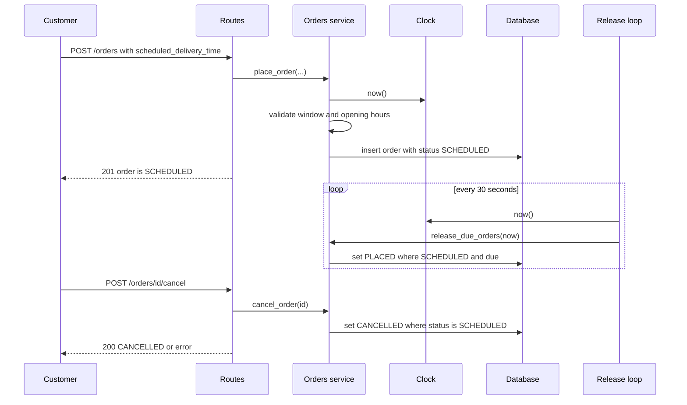

# Design — Track A: Scheduled Orders

## 1. Overview
[2-3 sentences: what this feature adds to MiniDash and which requirements it covers (AC-1 to AC-18).]

## 2. Components Touched

| Component | Change | Serves |
|---|---|---|
| routes.py | [what changes] | AC-? |
| services.py | [what changes] | AC-? |
| repository.py | [what changes] | AC-? |
| db.py | [what changes] | AC-? |
| main.py | [what changes] | AC-? |
| [any new file, e.g. clock or release module] | [purpose] | AC-? |

[Every row should map to at least one AC. Every AC should appear in at least one row.]

## 3. Data Changes
- New column(s) on `orders`: [name, type, nullable?]
- Statuses: [list them, and say which are new]
- Existing database file: Delete the local `minidash.db` and let the app recreate and reseed it, instead of writing a migration. The file holds only seed and test data, it is gitignored, and the tests already build a fresh database each time, so a migration would add code to write, test and explain for no benefit.

## 4. Interface Changes
- `POST /orders`: [new field, format, validation]
- Cancel: [your lean was POST /orders/{id}/cancel. Confirm it and say why: the cancel rule lives in one place, unlike reusing PATCH status]
- Release trigger: a background loop inside the app (see ADR-001)
- Error responses: [body shape with a code and a readable message. Table: error code -> HTTP status]
- `GET /orders/{id}`: [what the response adds]

## 5. Clock Design
[How "now" reaches the validation and release code, and what a test passes in.]

## 6. Diagram

## 7. ADR-001: Release scheduled orders with a background loop

**Status:** Proposed

**Context:** A scheduled order must move from SCHEDULED to PLACED once the clock is at or after 30 minutes before delivery (AC-10 to AC-12), and a cancelled order must never be released (AC-14). The API only runs code when a request arrives, so something has to notice time passing. User Story 3 says the restaurant should see orders appear on its own at that time. The baseline has no endpoint that lists orders. Constraints: one deployable, no new packages without justification, finished by Oct 30.

**Decision:** A small loop inside the app wakes every 30 seconds and calls one function, `release_due_orders(now)`, which takes the time from the injected clock. That function releases only orders still in SCHEDULED, using a single conditional update. The app is run with one worker. Tests call the function directly with a fake clock and the loop is disabled in tests.

**Consequences:**
- (+) Orders are released without anyone asking, which matches User Story 3.
- (+) The release rule lives in one function, so it is testable without waiting.
- (+) No new dependency.
- (-) More moving parts than release-on-read: a background thread, startup and shutdown, and a test switch to disable it.
- (-) A release can be up to 30 seconds late, which AC-10 allows ("at or after").
- (-) With several workers, each would run its own loop, so the app must run with one.

**Alternatives considered:**
- Release when an order is read: rejected because an order stays SCHEDULED until someone asks for it, and with no list endpoint the restaurant never sees it.
- APScheduler: rejected because it adds a dependency, does not help testing (the release function is still needed), and adds library behavior I would have to learn and explain.

## 8. Risks and Open Questions
- [Something that could go wrong, and what you'd do about it.]
- [Something you haven't decided yet.]
