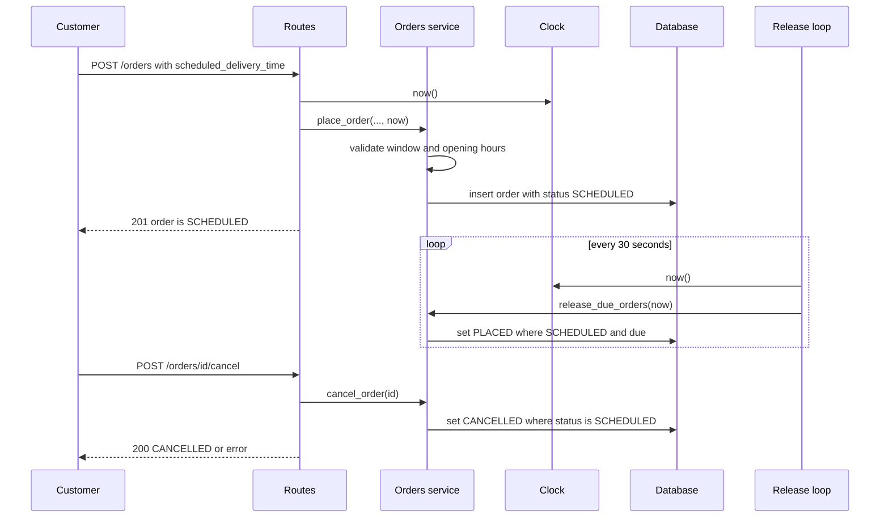

# Design — Track A: Scheduled Orders

## 1. Overview
This feature lets a customer schedule an order for delivery between 45 minutes and 7 days ahead. The order is held as SCHEDULED, released to the restaurant 30 minutes before delivery, and can be cancelled until then. It changes the order route, service, repository and database schema, and adds an injected clock, a cancel endpoint and a background release loop. It covers AC-1 to AC-19.

## 2. Components Touched
| Component | Change | Serves |
|---|---|---|
| routes.py | Accepts an optional scheduled_delivery_time on the order request, adds a POST /orders/{id}/cancel endpoint, and shows scheduled_delivery_time in the order response | AC-1 to 7, AC-13 to 18 |
| services.py | Checks the time window and restaurant opening hours, adds cancel, adds release_due_orders(now), and blocks status changes to or from SCHEDULED or CANCELLED | AC-1 to 17 |
| repository.py | Saves the time and updates the status only if the order is still SCHEDULED | AC-8 to 16 |
| db.py | Adds the scheduled_delivery_time column to the orders table | AC-8, AC-18 |
| main.py | Starts and stops the release loop and passes in the injected clock | AC-10 to 12, AC-19 |
| clock.py | A small Clock object so tests can set "now" | AC-19 |
| errors.py | An error type that carries a code, a message and an HTTP status, plus handlers that return the {"code", "message"} body | AC-3 to 7, AC-15, AC-16, AC-17 |

## 3. Data Changes
- New column on `orders`: scheduled_delivery_time, stored as text in ISO 8601 UTC like created_at. It can be empty because normal (non-scheduled) orders have no future delivery time and must keep the baseline behaviour of going straight to PLACED (AC-9, AC-18).
- Statuses: existing are PLACED, PREPARING, READY, PICKED_UP, DELIVERED, CANCELLED. The new one is SCHEDULED.
- Existing database file: Delete the local `minidash.db` and let the app recreate and reseed it, instead of writing a migration. The file holds only seed and test data, it is gitignored, and the tests already build a fresh database each time, so a migration would add code to write, test and explain for no benefit.

## 4. Interface Changes
- POST /orders: accepts an optional scheduled_delivery_time, an ISO 8601 string with a timezone offset. It is declared as a plain string, not a date type, because FastAPI would parse and reject a bad date on its own with its own error shape, so my SCHEDULE_INVALID (AC-3) could never surface. I need to validate the string myself and return my own error body.
- Cancel: POST /orders/{id}/cancel, because reusing PATCH /orders/{id}/status would let a caller set any status (e.g. force a CANCELLED order back to PLACED, or release an order that must never be released). A dedicated endpoint keeps the "only if currently SCHEDULED, never released afterwards" rule in one place (AC-13 to 16).
- Release trigger: a background loop inside the app (see ADR-001).
- Error responses: the body is `{"code": "...", "message": "..."}`.

| Error code | HTTP status | Message shown to the customer |
|---|---|---|
| ORDER_NOT_FOUND | 404 | We couldn't find that order. |
| STATUS_CHANGE_NOT_ALLOWED | 409 | This status change isn't allowed. Use the cancel endpoint to cancel an order. |
| SCHEDULE_INVALID | 422 | That delivery time isn't valid. Please send a date and time with a timezone. |
| SCHEDULE_TOO_SOON | 422 | Scheduled delivery must be at least 45 minutes from now. |
| SCHEDULE_TOO_FAR | 422 | Scheduled delivery can be at most 7 days from now. |
| RESTAURANT_CLOSED | 422 | The restaurant is closed at that time. Please pick a time during its opening hours. |
| ORDER_NOT_CANCELLABLE | 409 | This order can no longer be cancelled: it has already been sent to the restaurant or was cancelled already. |

- `GET /orders/{id}`: the response now includes scheduled_delivery_time, which is null when the order was not scheduled (AC-18).

## 5. Clock Design
A Clock in clock.py has a now() method that returns the current UTC datetime. Production uses the real time. Tests pass a fake clock with a fixed, settable datetime they can advance to cross the 45-minute, 7-day, and 30-minutes-before-delivery boundaries. Routes and the release loop read time from the clock and pass `now` into the services, and services never call datetime.now() directly. The baseline's place_order calls datetime.now() when no time is given, which must be removed because of AC-19.

## 6. Diagram

## 7. ADR-001: Release scheduled orders with a background loop
**Status:** Accepted

**Context:** A scheduled order must move from SCHEDULED to PLACED once the clock is at or after 30 minutes before delivery (AC-10 to AC-12), and a cancelled order must never be released (AC-13 to AC-16). The API only runs code when a request arrives, so something has to notice time passing. User Story 3 says the restaurant should see orders appear on its own at that time. The baseline has no endpoint that lists orders. Constraints: one deployable, no new packages without justification, finished by Oct 30.

**Decision:** A small loop inside the app wakes every 30 seconds and calls one function, `release_due_orders(now)`, which takes the time from the injected clock. That function releases only orders still in SCHEDULED, using a single conditional update. The app is run with one worker. Tests call the function directly with a fake clock and the loop is disabled in tests.

**Consequences:**

- (+) Orders are released without anyone asking, which matches User Story 3.
- (+) The release rule lives in one function, so it is testable without waiting.
- (+) No new dependency.
- (-) More moving parts than release-on-read: a background thread, startup and shutdown, and a test switch to disable it.
- (-) A release can be up to 30 seconds late, which AC-10 allows ("at or after").
- (-) With several workers, each would run its own loop, so the app must run with one.

**Alternatives considered:**

- Release when an order is read: rejected because an order stays SCHEDULED until someone asks for it, and with no list endpoint the restaurant never sees it.
- APScheduler: rejected because it adds a dependency, does not help testing (the release function is still needed), and adds library behavior I would have to learn and explain.

## 8. Risks and Open Questions
- Risk: tests start a background loop. Mitigation: the loop is disabled via a setting/flag in test configuration, and tests call release_due_orders(now) directly with a fake clock. One integration test deliberately enables the loop to prove it flips an order to PLACED without a manual trigger.
- Risk: release and cancel happen at the same moment. Mitigation: both paths use a conditional UPDATE ... WHERE status='SCHEDULED' in one transaction, so whichever wins leaves the order in exactly one status and the loser affects zero rows (AC-14, AC-15).
- Risk: more than one worker runs more than one loop. Mitigation: run the app with a single worker, and make release_due_orders idempotent so even duplicate loops cannot double-release an order (AC-12).
- Decision: PATCH /orders/{id}/status rejects any change to or from SCHEDULED or CANCELLED with STATUS_CHANGE_NOT_ALLOWED (409), so the cancel rule cannot be bypassed. Those statuses change only through the cancel endpoint and release_due_orders (AC-17).