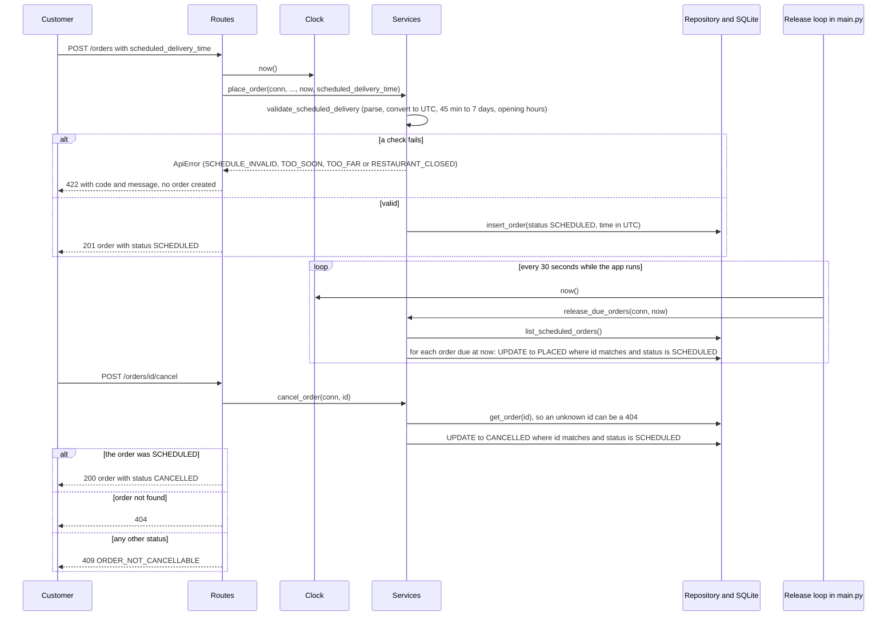

# Design — Track A: Scheduled Orders

## 1. Overview
This feature lets a customer schedule an order for delivery between 45 minutes and 7 days ahead. The order is held as SCHEDULED, released to the restaurant 30 minutes before delivery, and can be cancelled until then. It changes the order route, service, repository and database schema, and adds an injected clock, a cancel endpoint and a background release loop. It covers AC-1 to AC-19.

## 2. Components Touched
| Component | Change | Serves |
|---|---|---|
| routes.py | Accepts an optional scheduled_delivery_time on the order request and passes it, with `clock.now()`, to the service. Adds the POST /orders/{id}/cancel endpoint. A `get_clock` dependency hands routes the app's clock. The order response shows scheduled_delivery_time. | AC-1 to 9, AC-13 to 16, AC-18, AC-19 |
| services.py | `validate_scheduled_delivery` checks the timestamp, the 45-minute to 7-day window and the restaurant's opening hours. `place_order` takes `now` and creates SCHEDULED or PLACED orders. `cancel_order`. `release_due_orders(conn, now)`. `update_status` blocks changes to or from SCHEDULED or CANCELLED. | AC-1 to 17 |
| repository.py | `list_scheduled_orders` returns orders still SCHEDULED. `transition_order_status(order, expected, new)` changes the status only if the order currently has the expected status. The insert saves the scheduled time. | AC-8 to 16 |
| db.py | Adds the scheduled_delivery_time column to the orders table | AC-8, AC-18 |
| main.py | Starts and stops the release loop with the app (a thread, stopped by an event), stores the injected clock on the app, and registers the handler that returns the {"code", "message"} body. `create_app(db_path, clock, release_interval_seconds)`; the interval defaults to 30 and None switches the loop off. | AC-10 to 12, AC-19 |
| clock.py | `SystemClock`: its `now()` returns the current UTC time. The fake clock used in tests lives in tests/conftest.py, so production code carries no test-only class. | AC-19 |
| errors.py | `ApiError` carries a code, a message and an HTTP status, with one small function per error (schedule_invalid, schedule_too_soon, schedule_too_far, restaurant_closed, order_not_cancellable, status_change_not_allowed). | AC-3 to 7, AC-15, AC-17 |

Changed for presentation only, with no acceptance criterion: `docs_page.py` and the example bodies in `main.py` change how the /docs page looks and what it pre-fills. They do not change any endpoint.

## 3. Data Changes
- New column on `orders`: scheduled_delivery_time, stored as text in ISO 8601 UTC (the result of `datetime.isoformat()` on the UTC value, for example `2026-11-03T18:00:00+00:00`). It can be empty because normal (non-scheduled) orders have no future delivery time and must keep the baseline behaviour of going straight to PLACED (AC-9, AC-18). Times are compared as parsed datetimes, never as text, so the stored format cannot change the result.
- Statuses: existing are PLACED, PREPARING, READY, PICKED_UP, DELIVERED, CANCELLED. The new one is SCHEDULED, which is also added to the list of known statuses so that a request to set it is rejected with STATUS_CHANGE_NOT_ALLOWED and not as an unknown value.
- Existing database file: Delete the local `minidash.db` and let the app recreate and reseed it, instead of writing a migration. The file holds only seed and test data, it is gitignored, and the tests already build a fresh database each time, so a migration would add code to write, test and explain for no benefit.

## 4. Interface Changes
- POST /orders: accepts an optional scheduled_delivery_time, an ISO 8601 string with a timezone offset. It is declared as a plain string, not a date type, because FastAPI would parse and reject a bad date on its own with its own error shape, so my SCHEDULE_INVALID (AC-3) could never surface. I need to validate the string myself and return my own error body. The checks run after the baseline request checks (unknown restaurant, items, address) and before anything is saved, so a rejected request creates no order. They run in the order fixed by AC-6: invalid, too soon, too far, restaurant closed. A value that is not a string at all (for example a number) is rejected by FastAPI with its own `detail` body, not SCHEDULE_INVALID.
- Cancel: POST /orders/{id}/cancel, because reusing PATCH /orders/{id}/status would let a caller set any status (e.g. force a CANCELLED order back to PLACED, or release an order that must never be released). A dedicated endpoint keeps the "only if currently SCHEDULED, never released afterwards" rule in one place (AC-13 to 16). It returns 200 with the cancelled order, 409 ORDER_NOT_CANCELLABLE for any other status, and 404 for an unknown order.
- Release trigger: a background loop inside the app (see ADR-001).
- `PATCH /orders/{id}/status`: an unknown status value is still a 422, an unknown order is still a 404, and then a change to or from SCHEDULED or CANCELLED is a 409 STATUS_CHANGE_NOT_ALLOWED (AC-17). Changes between the other statuses work as in the baseline.
- Error responses: new scheduling and cancel errors use the body `{"code": "...", "message": "..."}`. Baseline errors (including the 404 for an unknown order, AC-16) keep their existing `{"detail": ...}` body.

| Error code | HTTP status | Message shown to the customer |
|---|---|---|
| STATUS_CHANGE_NOT_ALLOWED | 409 | This status change isn't allowed. Use the cancel endpoint to cancel an order. |
| SCHEDULE_INVALID | 422 | That delivery time isn't valid. Please send a date and time with a timezone. |
| SCHEDULE_TOO_SOON | 422 | Scheduled delivery must be at least 45 minutes from now. |
| SCHEDULE_TOO_FAR | 422 | Scheduled delivery can be at most 7 days from now. |
| RESTAURANT_CLOSED | 422 | The restaurant is closed at that time. Please pick a time during its opening hours. |
| ORDER_NOT_CANCELLABLE | 409 | This order can no longer be cancelled: it has already been sent to the restaurant or was cancelled already. |

- `GET /orders/{id}`: the response now includes scheduled_delivery_time, which is null when the order was not scheduled (AC-18).

## 5. Clock Design
`SystemClock` in clock.py has a now() method that returns the current UTC datetime. `create_app` stores one clock on the app (`app.state.clock`), the real one by default. Routes get it through a `get_clock` dependency and pass `clock.now()` into the services as `now`, and the release loop reads the same clock on every pass. Services never call datetime.now() directly, and `place_order` now requires `now` (the baseline fallback that called datetime.now() was removed because of AC-19). A test scans the source files and fails if anything except clock.py reads the wall clock.

Tests pass a fake clock (in tests/conftest.py) with a fixed, settable datetime that they can advance to cross the 45-minute, 7-day, and 30-minutes-before-delivery boundaries without waiting.

## 6. Diagram

## 7. ADR-001: Release scheduled orders with a background loop
**Status:** Accepted

**Context:** A scheduled order must move from SCHEDULED to PLACED once the clock is at or after 30 minutes before delivery (AC-10 to AC-12), and a cancelled order must never be released (AC-13 to AC-16). The API only runs code when a request arrives, so something has to notice time passing. User Story 3 says the restaurant should see orders appear on its own at that time. The baseline has no endpoint that lists orders. Constraints: one deployable, no new packages without justification, finished by Oct 30.

**Decision:** A small loop inside the app wakes every 30 seconds and calls one function, `release_due_orders(now)`, which takes the time from the injected clock. That function releases only orders still in SCHEDULED, using a single conditional update. The app is run with one worker. Tests call the function directly with a fake clock and the loop is disabled in tests.

**Consequences:**

- (+) Orders are released without anyone asking, which matches User Story 3.
- (+) The release rule lives in one function, so it is testable without waiting.
- (+) No new dependency.
- (-) More moving parts than release-on-read: a background thread, startup and shutdown, and a test switch to disable it.
- (-) A release can be up to 30 seconds late, which AC-10 allows ("at or after").
- (-) With several workers, each would run its own loop, so the app must run with one.

**Update after implementation:** the decision stands. Two details changed while building it. First, `release_due_orders(conn, now)` first lists the orders that are still SCHEDULED, then decides in Python, using parsed UTC datetimes, which of them are due (now is at or after delivery time minus 30 minutes). Doing the comparison on the stored text in SQL would only be correct while every stored value has exactly the same format. Second, each due order is then moved with its own conditional update (`UPDATE ... WHERE id = ? AND status = 'SCHEDULED'`) and counted as released only if a row changed, instead of one update for all due orders. The safety property is the same: an order that was cancelled or already released after it was listed is not changed. The loop runs in a thread that is stopped through an event when the app shuts down, a failed pass is logged and the loop carries on, and the 30-second interval is a `create_app` argument so tests can use a tiny one.

**Alternatives considered:**

- Release when an order is read: rejected because an order stays SCHEDULED until someone asks for it, and with no list endpoint the restaurant never sees it.
- APScheduler: rejected because it adds a dependency, does not help testing (the release function is still needed), and adds library behavior I would have to learn and explain.

## 8. Risks and Open Questions
- Risk: tests start a background loop. Mitigation: `create_app(release_interval_seconds=None)` switches the loop off, the ordinary test client uses it, and tests call release_due_orders(conn, now) directly with a fake clock. Separate tests enable the loop with a very short interval and wait for passes to finish (not for time to pass) to prove that it releases a due order without a manual call, never releases a cancelled one, starts and stops with the app, and survives a failed pass.
- Risk: release and cancel happen at the same moment. Mitigation: both paths use a conditional UPDATE ... WHERE status='SCHEDULED', so whichever wins leaves the order in exactly one status and the loser affects zero rows (AC-14, AC-15). A test makes the cancel win after release has listed the order and checks that the order stays CANCELLED.
- Risk: more than one worker runs more than one loop. Mitigation: run the app with a single worker, and make release_due_orders idempotent so even duplicate loops cannot double-release an order (AC-12). Several workers are not tested.
- Decision: PATCH /orders/{id}/status rejects any change to or from SCHEDULED or CANCELLED with STATUS_CHANGE_NOT_ALLOWED (409), so the cancel rule cannot be bypassed. Those statuses change only through the cancel endpoint and release_due_orders (AC-17).

## 9. Known Limitations
- Opening hours are `HH:MM` text read as UTC time of day, with no local-time or daylight-saving handling. Restaurants that close after midnight are not supported (out of scope in requirements.md).
- Each release pass loads every SCHEDULED order. That is fine at this size and would need an index or a query on the due time at scale.
- An order can be released up to about 30 seconds after its release time, because the loop wakes every 30 seconds. AC-10 allows this ("at or after").
- A scheduled_delivery_time that is not a string gets FastAPI's default 422 response, not SCHEDULE_INVALID.
- Concurrent cancel and release are covered by a simulated race, not by a test that runs two requests truly at the same time.